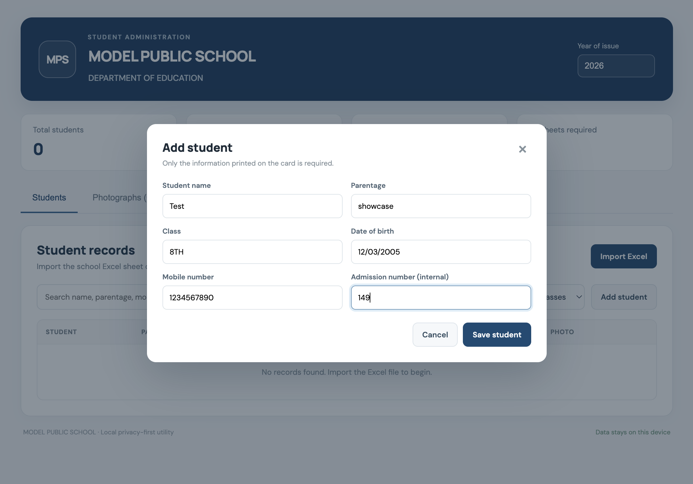
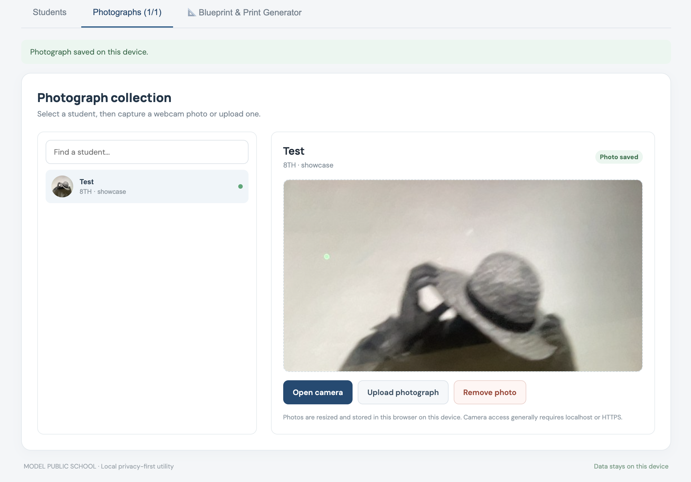
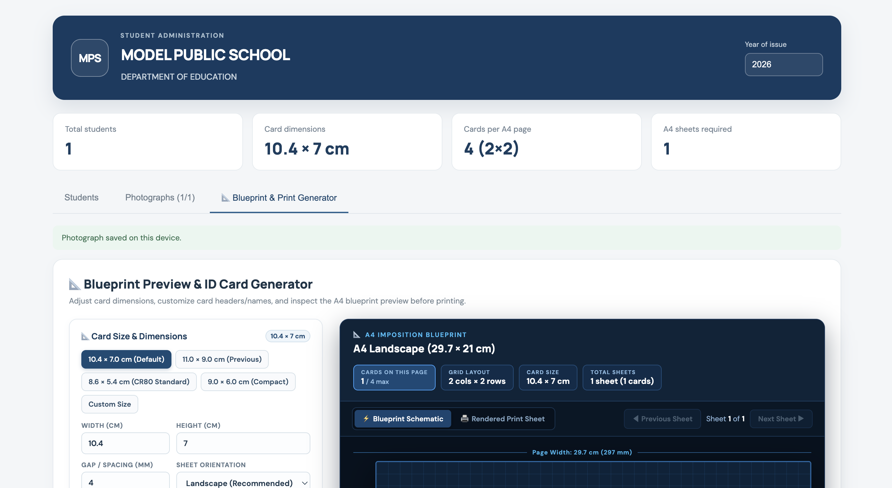
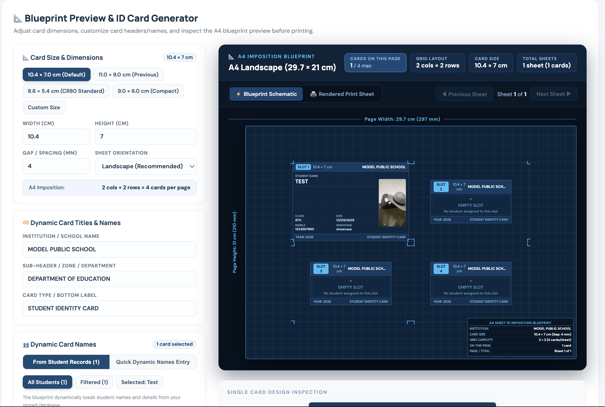
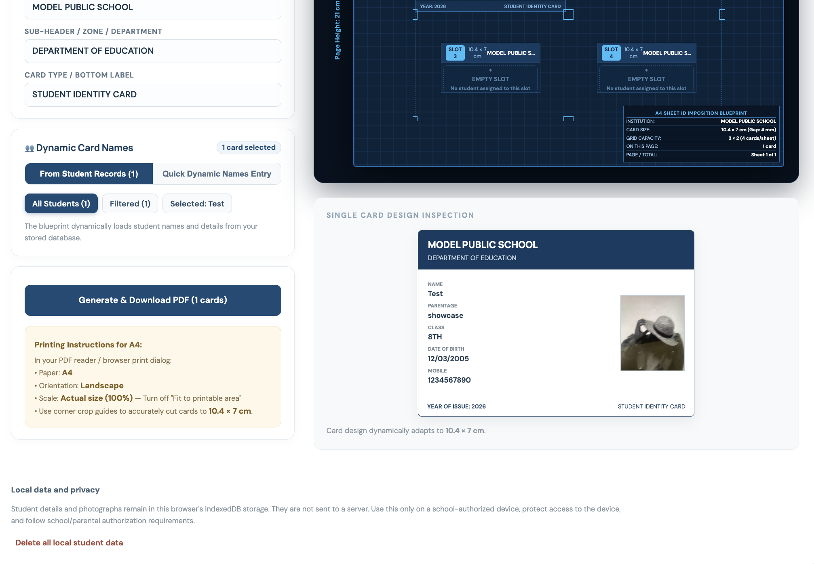
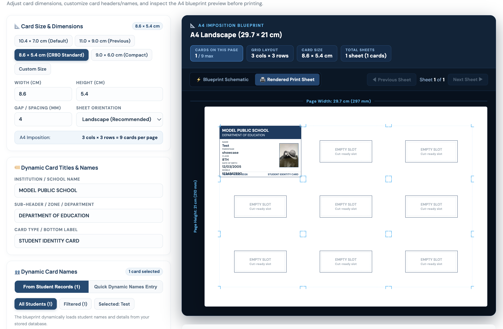

# Student ID Card Generator & Blueprint Print System

> **A local-first, privacy-focused browser application built to solve a real-world problem for non-tech-savvy school administrators: effortlessly transforming Excel registers into print-ready, millimeter-precise student ID cards on standard A4 paper.**

[](https://react.dev/)
[](https://www.typescriptlang.org/)
[](https://vitejs.dev/)
[](#privacy--data-protection)
[](LICENSE)

---

## 💡 The Story: Why I Built This

I built this application for my father's government school.

Every academic year, school teachers and administrative staff face the tedious task of creating identity cards for dozens of students. For government and local schools, this usually means one of two frustrating options:
1. **Outsourcing to private printing vendors:** This is expensive, takes weeks of back-and-forth communication, and frequently results in typographical errors in student names, fathers' names, or dates of birth.
2. **Struggling with complex software:** Existing digital tools like Photoshop, Canva, Mail Merge, or bulky school ERPs require steep learning curves, expensive subscriptions, and powerful computers.

The school staff are educators, not graphic designers or IT engineers. They needed a solution that:
- **Requires zero technical expertise:** Simply load the Excel sheet they already maintain, attach photos, and click Print.
- **Works completely offline without recurring costs or accounts:** No server infrastructure to manage, no recurring SaaS subscriptions, and no complicated installation rituals.
- **Respects student privacy:** Student records, contact numbers, and children's photographs must never be uploaded to third-party cloud servers.
- **Provides guaranteed print precision:** Printing ID cards on desktop printers usually results in scaled-down, misaligned cards that do not fit standard plastic lamination pouches.

This tool solves all of these challenges in a clean, foolproof, single-page application.

---

## ✨ Features

### 📂 1. Smart Excel Import
- Imports directly from the standard class register spreadsheets (.xlsx / .xls).
- **Tolerant header detection:** Automatically locates student fields (`Name of Student`, `Parentage`, `Class`, `Date of Birth`, `Mobile no`, `Admission Number`) without assuming headers are on row 1.
- Immediate inline table preview with search, class filtering, and manual record editing.


### 📸 2. Integrated Camera & Photo Studio
- **Webcam capture:** Snap photos directly from a laptop webcam or mobile device with a single click.
- **File upload:** Drag-and-drop existing passport-style photos.
- Automatic square/aspect ratio cropping and thumbnail storage in browser IndexedDB.
- Visual completion badges showing which students have photos attached.


### 📐 3. Architectural Blueprint & Imposition Engine
- **A4 Live Blueprint Preview:** Interactive CAD-style visual blueprint displaying exact sheet geometry (297 mm × 210 mm) with real millimeter callouts.
- **Card Size Presets:**
  - `10.4 × 7.0 cm` (Optimized ID badge format)
  - `11.0 × 9.0 cm` (Standard school card format)
  - `8.6 × 5.4 cm` (CR80 standard credit-card format)
  - `9.0 × 6.0 cm` (Compact badge format)
  - **Custom Dimensions:** Arbitrary user-defined width, height, and gap spacing.
- **Intelligent Grid Calculation:** Automatically calculates optimal row/column distribution (e.g. 2 columns × 2 rows = 4 cards per sheet), sheet margins, and landscape/portrait orientation.
- **Millimeter Cut Tick-Marks:** Built-in cutting guides for easy slicing with a ruler or paper cutter.




### ⚡ 4. Client-Side Vector PDF Export
- Generates crisp, high-resolution vector PDFs directly in the browser via `pdf-lib`.
- Embeds student photos, standardized typography (Helvetica), school branding, and barcode/identifier metadata.
- Instant download with zero server latency.

### 🔒 5. 100% Privacy & Offline-First
- All student data and photos persist strictly inside the user's browser via **IndexedDB**.
- **Zero telemetry, zero analytics, zero external API calls.**
- Safe for sensitive children's personal information.

---

## 🚀 Quick Start (Mac, Linux & Windows)

### Prerequisites
- [Node.js](https://nodejs.org/) (version 18 or 20+ LTS recommended)
- Modern web browser (Google Chrome, Microsoft Edge, Safari, Firefox)

### Installation & Launch

```bash
# 1. Install
git clone 
# 2. Navigate to the application directory
cd student-id-card-system

# 3. Install dependencies
npm install

# 4. Start local development server
npm run dev
```

Once started, open the local URL displayed in your terminal (typically **`http://localhost:5173`**).

---

## 🖨️ Printing Instructions for Perfect Results

When printing the generated PDF on an office desktop printer:

1. Open the exported PDF in your browser or Adobe Acrobat / Preview.
2. Open the **Print Dialog** (`Cmd + P` or `Ctrl + P`).
3. Configure print settings:
   - **Paper Size:** `A4`
   - **Scale:** `100%` / `Actual Size` *(Do NOT select "Fit to Printable Area" or "Shrink to Fit")*
   - **Orientation:** `Landscape` (or match the preset selected)
4. Print one test page on plain paper and measure the printed card with a ruler before printing full batches on heavy cardstock or photo paper.
5. Cut along the subtle corner tick-marks and slide cards into standard ID lamination pouches.

---

## 🛠️ Tech Stack & Architecture

- **Framework:** [React 19](https://react.dev/) + [TypeScript](https://www.typescriptlang.org/)
- **Build Tool:** [Vite](https://vitejs.dev/)
- **PDF Generation:** [`pdf-lib`](https://pdf-lib.js.org/) (client-side PDF vector synthesis & image embedding)
- **Spreadsheet Parsing:** [`xlsx` (SheetJS)](https://sheetjs.com/)
- **Persistence:** Browser [IndexedDB](https://developer.mozilla.org/en-US/docs/Web/API/IndexedDB_API)
- **Styling:** Custom CSS with responsive grid layout and dark/blueprint themes

---

## 📁 Repository Structure

```text
├── student-id-card-system/       # Main React + Vite web application
│   ├── src/
│   │   ├── App.tsx               # Main application container & state management
│   │   ├── BlueprintPreview.tsx  # Architectural CAD blueprint preview component
│   │   ├── layout.ts             # Math & geometry imposition engine (A4 grid calculations)
│   │   ├── pdf.ts                # Client-side PDF generation engine (pdf-lib)
│   │   ├── excel.ts              # Robust spreadsheet parsing & column mapper
│   │   ├── storage.ts            # IndexedDB local storage adapter
│   │   ├── types.ts              # Core TypeScript models & preset configurations
│   │   └── styles.css            # Responsive layout & blueprint visualization styles
│   ├── index.html                # Entry HTML document
│   ├── package.json              # Project dependencies & scripts
│   └── vite.config.ts            # Vite configuration
├── launch-app.bat / .ps1         # (Optional) One-click background launcher for Windows
├── stop-app.bat / .ps1           # (Optional) Process stopper for Windows
├── create-desktop-shortcuts.ps1  # (Optional) Helper to create Desktop shortcuts on Windows
└── README.md                     # Documentation & project overview
```

---

## 📄 License

This project is open-source and available under the [MIT License](LICENSE). Feel free to adapt it for your own school, university, or organization!
